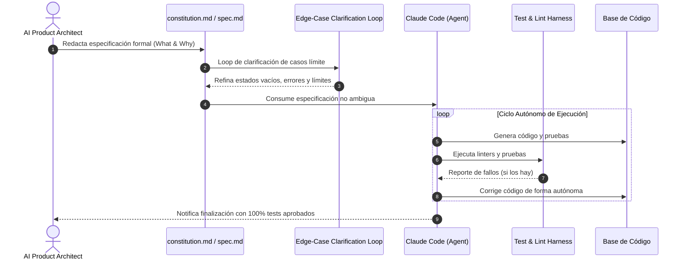
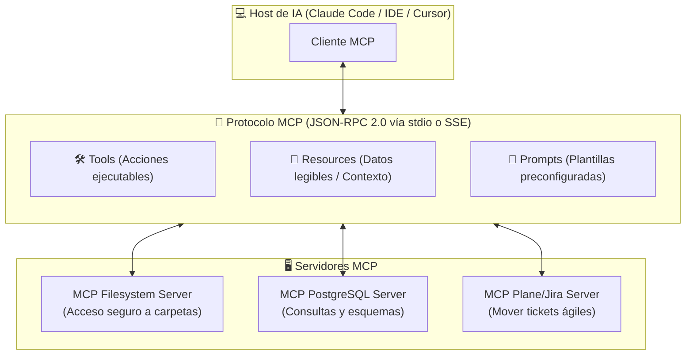
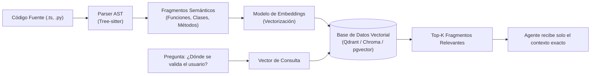

# 🏛️ Manual Maestro de Estudio: Diploma en AI-First Software Architecture
> **Institución**: DMC Institute • **Carga Académica**: 92 Horas • 23 Sesiones • 62 Talleres Prácticos  
> **Perfil Formativo**: Arquitecto de Producto IA & Tech Lead (*AI Product Architect*)  
> **Metodologías Núcleo**: *Spec-Driven Development (SDD)*, *BMAD Framework*, *Model Context Protocol (MCP)*, *Harness Engineering*

---

## 📑 Tabla de Contenidos

1. [El Cambio de Paradigma: Del Programador Artesanal al AI Product Architect](#1-el-cambio-de-paradigma-del-programador-artesanal-al-ai-product-architect)
2. [Bibliografía Canónica y Literatura Obligatoria](#2-bibliografía-canónica-y-literatura-obligatoria)
3. [Metodología SDD (*Spec-Driven Development*) y Framework BMAD](#3-metodología-sdd-spec-driven-development-y-framework-bmad)
4. [Model Context Protocol (MCP): Arquitectura y Funcionamiento Interno](#4-model-context-protocol-mcp-arquitectura-y-funcionamiento-interno)
5. [Indexación Semántica y RAG sobre Bases de Código](#5-indexación-semántica-y-rag-sobre-bases-de-código)
6. [Harness Engineering y Agentes Autónomos de Terminal](#6-harness-engineering-y-agentes-autónomos-de-terminal)
7. [Orquestación del Ciclo de Vida: Plane/Jira, OpenAPI y Reportes Autónomos](#7-orquestación-del-ciclo-de-vida-planejira-openapi-y-reportes-autónomos)
8. [QA Aumentado, Seguridad y Despliegue Corporativo (CI/CD, Docker, Prometheus)](#8-qa-aumentado-seguridad-y-despliegue-corporativo-cicd-docker-prometheus)
9. [Laboratorios y Talleres Prácticos con Código Fuente](#9-laboratorios-y-talleres-prácticos-con-código-fuente)
10. [Buscador Curado de Tutoriales y Recursos](#10-buscador-curado-de-tutoriales-y-recursos)
11. [Banco de Preguntas para Evaluaciones y Sustentación (Demo Day)](#11-banco-de-preguntas-para-evaluaciones-y-sustentación-demo-day)

---

## 1. El Cambio de Paradigma: Del Programador Artesanal al AI Product Architect

La ingeniería de software ha entrado en la era post-sintáctica. El cuello de botella histórico (escribir sintaxis y código repetitivo a mano) ha desaparecido gracias a los modelos fundacionales. El nuevo cuello de botella es la **definición precisa de la intención, el control de la ambigüedad y la arquitectura de los sistemas**.

```mermaid
flowchart TD
    subgraph Antiguo["🛠️ Era Tradicional (Code-Centric)"]
        H1["Humano escribe cada línea de código"] --> T1["Humano escribe tests a mano"]
        T1 --> D1["Humano despliega manualmente"]
    end

    subgraph Transición["⚠️ Era 'Vibe Coding' (Riesgosa)"]
        H2["Humano pasa prompts informales"] --> LLM2["IA genera código desordenado"]
        LLM2 --> Debt["Acumulación masiva de deuda técnica y bugs"]
    end

    subgraph Moderno["🚀 Era AI-First (Spec-Driven & Harness)"]
        Arch["AI Product Architect redacta Especificación Formal (SDD)"] --> Guard["Guardrails deterministas (Linter, Tipos, MCP)"]
        Guard --> Agent["Agente Autónomo (Claude Code) ejecuta en un Harness"]
        Agent --> Eval["Evaluación continua y CI/CD con Docker"]
    end

    style Moderno fill:#0f172a,stroke:#38bdf8,color:#fff
```



### ¿Qué hace un *AI Product Architect*?
1. **No escribe código línea a línea**: Diseña las reglas de negocio, modelos de datos y restricciones del sistema mediante **especificaciones formales ejecutables**.
2. **Construye el *Harness* (Arnés de Ejecución)**: Diseña el entorno cerrado y seguro en el cual los agentes operan (linters, pruebas de regresión, tipado estricto, sandbox de terminal).
3. **Expone Contexto mediante MCP**: Crea servidores que permiten a los agentes consultar bases de datos, APIs de negocio y gestores de tareas sin intermediarios humanos.
4. **Gobernanza y Calidad**: Asegura que el software producido por los agentes cumpla con estándares de seguridad (OWASP), rendimiento y disponibilidad antes de llegar a producción.

---

## 2. Bibliografía Canónica y Literatura Obligatoria

Estudiar estos libros y artículos fundamentales te dará el lenguaje y rigor técnico de un arquitecto experimentado:

### 📚 Bloque 1: Arquitectura de Software y Sistemas Distribuidos
1. **"Building Microservices: Designing Fine-Grained Systems" (2nd Edition)** — *Sam Newman (O'Reilly)*
   * **Capítulo 4**: *Integration* (Evitar base de datos compartida, comunicación orientada a eventos).
   * **Capítulo 9**: *Security* (Autenticación y autorización en sistemas distribuidos).
   * *¿Por qué leerlo?* Fundamental para diseñar la arquitectura desacoplada que se exige en el Módulo II.
2. **"Working Effectively with Legacy Code"** — *Michael Feathers*
   * **Capítulo 2**: *Working with Feedback* (La definición de un arnés de pruebas).
   * **Capítulo 6**: *I Need to Make a Change, but I Don't Know What Tests to Write*.
   * *¿Por qué leerlo?* El Módulo III incluye refactorización profunda de código legado con agentes. Feathers define las técnicas exactas de costuras (*seams*) y tests de caracterización.
3. **"Software Architecture: The Hard Parts"** — *Neal Ford, Mark Richards, Pramod Sadalage, Zhamak Dehghani*
   * **Capítulo 3**: *Component-Based Decomposition*.
   * **Capítulo 8**: *Orchestration vs. Choreography*.

### 📚 Bloque 2: Literatura AI-First y Evaluación de Agentes
4. **"AI Engineering: Building Applications with Foundation Models"** — *Chip Huyen (2024)*
   * **Capítulo 5**: *Retrieval-Augmented Generation (RAG)* (Búsqueda vectorial e indexación semántica).
   * **Capítulo 6**: *Agents and Tool Use* (Arquitectura ReAct, Function Calling y protocolos de contexto).
5. **"Martin Fowler on Harness Engineering & AI-Assisted Architecture"** (Artículos de MartinFowler.com):
   * *The Ambiguity Tax in AI-Driven Development* (Cómo la falta de especificaciones destruye la velocidad).
   * *Harness Mechanisms: Balancing Deterministic and Inferential Checks*.
6. **"Anthropic Research: Building Effective Agents"** (Guía Técnica Oficial de Anthropic, 2024):
   * Arquitecturas de orquestador-subagentes, evaluadores independientes y workflows de código de larga duración.

---

## 3. Metodología SDD (*Spec-Driven Development*) y Framework BMAD

### 🔬 ¿Por qué fracasa el "Vibe Coding"?
El "Vibe Coding" (programar pidiendo cosas al chat sin estructura) fracasa por el **Impuesto de Ambigüedad (*Ambiguity Tax*)**: cuando un LLM recibe un prompt incompleto, se ve forzado a asumir decisiones arquitectónicas. Esas suposiciones generan divergencias acumulativas que provocan fallos de integración, alucinaciones y código frágil.

### 🔬 El Flujo SDD (*Spec-Driven Development*)
SDD resuelve este problema convirtiendo las especificaciones en **artefactos de primera clase en el repositorio Git**:



### 🔬 El Framework BMAD (*Build More Architect Dreams / Breakthrough Method*)
BMAD estructura el ciclo en compuertas serializadas manejadas por roles de agentes especializados:
1. **Analyst Agent (`project_brief.md`)**: Cuestiona supuestos de negocio y define el alcance macro.
2. **Product Manager Agent (`prd.md`)**: Estructura épicas, historias de usuario y criterios de aceptación verificables.
3. **Architect Agent (`spec.md`)**: Define modelos de datos, contratos de API (OpenAPI), endpoints y contratos de error.
4. **Developer Agent**: Implementa el código contra la especificación con cero margen para adivinanzas.

---

## 4. Model Context Protocol (MCP): Arquitectura y Funcionamiento Interno

**MCP** es el estándar abierto propuesto por Anthropic para resolver el problema de $N \times M$ integraciones. En lugar de que cada IA tenga que programar un conector para PostgreSQL, otro para Slack y otro para GitHub, MCP unifica todo bajo un protocolo universal cliente-servidor:



### Los Tres Primitivos de MCP:
* **Resources (Recursos)**: Datos pasivos que el agente puede leer para obtener contexto (como esquemas de base de datos, logs o archivos de configuración). Funcionan de forma similar a peticiones `GET`.
* **Tools (Herramientas)**: Funciones activas que el modelo puede decidir invocar con argumentos estructurados (ej. `execute_query(sql)`, `create_jira_issue(title)`).
* **Prompts**: Plantillas reutilizables provistas por el servidor para guiar interacciones específicas.

---

## 5. Indexación Semántica y RAG sobre Bases de Código

Para que un agente comprenda una base de código de más de 100,000 líneas de código sin desbordar el *Context Window*:



1. **Chunking basado en AST (*Abstract Syntax Tree*)**: No se corta el archivo por cantidad de caracteres (eso rompería funciones por la mitad); se utiliza un analizador sintáctico (como **Tree-sitter**) para extraer funciones y clases completas.
2. **Embeddings de Código**: Se transforman los fragmentos de código en vectores numéricos de alta dimensionalidad.
3. **Recuperación Semántica (*Retrieval*)**: Cuando el agente busca "cómo se maneja la caché", el sistema recupera únicamente [`LRUCache.ts`](../features/github-search/lib/LRUCache.ts) y lo inyecta en el prompt.

---

## 6. Harness Engineering y Agentes Autónomos de Terminal

El concepto de **Harness (Arnés de Ingeniería)** proviene de la aeronáutica y el testeo automotriz: es la estructura de soporte y pruebas que permite encender un motor de alto poder sin que se destruya.

### El Bucle de un Agente con Harness (*Closed-Loop Execution*):
1. **Planificación**: El agente analiza la tarea y escribe un plan de acción atómico.
2. **Acción**: Modifica un archivo o ejecuta un comando.
3. **Observación**: El arnés ejecuta automáticamente el compilador (`tsc`) y el linter (`eslint`).
4. **Reflexión y Auto-corrección**: Si el compilador arroja un error de tipado, el agente lee el *stack trace*, reconoce el fallo y genera una nueva solución sin intervención humana.

---

## 7. Orquestación del Ciclo de Vida: Plane/Jira, OpenAPI y Reportes Autónomos

En el Módulo IV se automatiza la burocracia del desarrollo de software:

* **Sincronización Bidireccional con Plane/Jira**:
  * Un servidor MCP expone las tareas de la iteración.
  * Cuando el agente termina la especificación `SPEC-001` y los tests pasan, invoca `update_task_status(id="HU-42", status="In Review", pr_url="...")`.
* **Living Documentation (Documentación Viva)**:
  * El código es la fuente de la verdad. Un script impulsado por IA analiza los decoradores y tipos de TypeScript para auto-generar la especificación `openapi.yaml`.
* **Automated Daily Reports**:
  * El agente extrae el `git log` de las últimas 24 horas y redacta un reporte ejecutivo en Markdown con tres secciones:
    1. *Funcionalidades entregadas a producción*.
    2. *Deuda técnica o refactorizaciones abordadas*.
    3. *Bloqueos identificados que requieren intervención de arquitectura*.

---

## 8. QA Aumentado, Seguridad y Despliegue Corporativo (CI/CD, Docker, Prometheus)

### 🔬 OWASP Top 10 para Código Generado por LLMs
Los agentes pueden introducir vulnerabilidades inadvertidas si no se auditan:
* **Inyección SQL / NoSQL**: Generación de queries con concatenación directa de strings.
* **Insecure Direct Object References (IDOR)**: Olvidar comprobar si el `userId` autenticado es dueño del recurso solicitado.
* **Exposición de Secretos**: Dejar API Keys o credenciales hardcodeadas en scripts de prueba.

### 🔬 Monitoreo y Observabilidad con Prometheus
Una vez desplegada "The Agentic App", se monitorean cuatro métricas de oro:
1. **Latencia**: Tiempo de respuesta de las peticiones a la API y llamadas al LLM.
2. **Tráfico**: Número de solicitudes por segundo (RPS).
3. **Errores**: Tasa de fallos HTTP 5xx y errores de validación de esquemas Zod.
4. **Saturación**: Consumo de memoria RAM y CPU de los contenedores Docker.

---

## 9. Laboratorios y Talleres Prácticos con Código Fuente

### 🛠️ Taller 1: Servidor MCP en TypeScript para Monitoreo de Repositorios
Crea un servidor MCP que exponga herramientas a Claude Code:

```typescript
// mcp-server.ts
import { Server } from "@modelcontextprotocol/sdk/server/index.js";
import { StdioServerTransport } from "@modelcontextprotocol/sdk/server/stdio.js";
import {
    CallToolRequestSchema,
    ListToolsRequestSchema,
} from "@modelcontextprotocol/sdk/types.js";

const server = new Server(
    { name: "github-intelligence-mcp", version: "1.0.0" },
    { capabilities: { tools: {} } }
);

// 1. Definición de herramientas expuestas al agente
server.setRequestHandler(ListToolsRequestSchema, async () => {
    return {
        tools: [
            {
                name: "calculate_repo_health",
                description: "Calcula el puntaje de salud (0-100) de un repositorio de GitHub analizando commits y issues.",
                inputSchema: {
                    type: "object",
                    properties: {
                        stars: { type: "number", description: "Número de estrellas del repositorio" },
                        openIssues: { type: "number", description: "Cantidad de issues abiertos" },
                        hasLicense: { type: "boolean", description: "Si cuenta con archivo LICENSE" }
                    },
                    required: ["stars", "openIssues", "hasLicense"]
                }
            }
        ]
    };
});

// 2. Ejecución determinista de la lógica
server.setRequestHandler(CallToolRequestSchema, async (request) => {
    if (request.params.name === "calculate_repo_health") {
        const { stars, openIssues, hasLicense } = request.params.arguments as any;
        
        let score = 50;
        if (hasLicense) score += 20;
        if (stars > 100) score += 20;
        if (openIssues > 50) score -= 15;
        score = Math.max(0, Math.min(100, score));

        return {
            content: [
                {
                    type: "text",
                    text: JSON.stringify({ healthScore: score, status: score >= 70 ? "Healthy" : "Needs Review" })
                }
            ]
        };
    }
    throw new Error("Herramienta no encontrada");
});

async function main() {
    const transport = new StdioServerTransport();
    await server.connect(transport);
}

main().catch(console.error);
```

### 🛠️ Taller 2: Pipeline de CI/CD Seguro con GitHub Actions (`.github/workflows/ai-ci.yml`)
Este pipeline actúa como el guardrail externo del agente:

```yaml
name: AI-First Continuous Integration

on:
  push:
    branches: [ main, develop ]
  pull_request:
    branches: [ main ]

jobs:
  audit-and-test:
    runs-on: ubuntu-latest
    steps:
      - name: Checkout Repositorio
        uses: actions/checkout@v4

      - name: Configurar Node.js y pnpm
        uses: pnpm/action-setup@v3
        with:
          version: 9
      - uses: actions/setup-node@v4
        with:
          node-version: 20
          cache: 'pnpm'

      - name: Instalar Dependencias
        run: pnpm install --frozen-lockfile

      - name: Verificación Estricta de Tipos (TypeScript)
        run: pnpm exec tsc --noEmit

      - name: Linter y Reglas de Calidad
        run: pnpm run lint

      - name: Suite de Pruebas Automatizadas de Edge Cases
        run: node features/github-search/lib/__tests__/qa_audit_test.mjs

      - name: Auditoría de Seguridad de Dependencias
        run: pnpm audit --audit-level=high
```

---

## 10. Buscador Curado de Tutoriales y Recursos

### 📺 Tutoriales y Charlas de Conferencia (YouTube)
* **Anthropic Developers Channel**:
  * Búsqueda: `"Model Context Protocol MCP announcement and tutorial Anthropic"`
  * Búsqueda: `"Building Effective Agents Anthropic guide walk-through"`
* **Martin Fowler / ThoughtWorks**:
  * Búsqueda: `"Martin Fowler Software Architecture in the Age of AI"`
* **Hussein Nasser**:
  * Búsqueda: `"Docker networking and container architecture deep dive"`
* **TechWorld with Nana**:
  * Búsqueda: `"Prometheus and Grafana complete monitoring tutorial in 1 hour"`

### 📑 Sitios Web de Referencia
* [Model Context Protocol Specification](https://modelcontextprotocol.io/)
* [OpenCode & Claude Code Documentation](https://docs.anthropic.com/en/docs/agents-and-tools/claude-code/)
* [OWASP Top 10 for Large Language Model Applications](https://owasp.org/www-project-top-10-for-large-language-model-applications/)

---

## 11. Banco de Preguntas para Evaluaciones y Sustentación (Demo Day)

1. **¿Qué diferencia conceptual existe entre un Servidor MCP y una API REST tradicional?**
   * *Respuesta*: Una API REST está pensada para que un frontend o sistema externo consuma datos bajo contratos HTTP definidos manualmente. Un Servidor MCP expone dinámicamente metadatos estructurados (esquemas JSON de Tools, Resources y Prompts) bajo el protocolo JSON-RPC para que cualquier agente LLM descubra, comprenda y ejecute herramientas en tiempo de ejecución sin escribir adaptadores específicos.
2. **¿Por qué la metodología Spec-Driven Development (SDD) previene la degradación arquitectónica en equipos asistidos por IA?**
   * *Respuesta*: Porque desacopla el diseño de la implementación. Al fijar primero la arquitectura, modelos y contratos de aceptación en un documento formal (`spec.md`), la IA solo se encarga de la generación de código acotado a esos límites, impidiendo la dispersión y la deuda técnica acumulativa.
3. **¿Cuál es el rol de un arnés de pruebas (*Test Harness*) en un flujo de agentes de terminal autónomos?**
   * *Respuesta*: Proveer el bucle de retroalimentación determinista (*Feedback Loop*). El arnés valida el código generado mediante linters, análisis de tipos y pruebas unitarias. Si algo falla, el error es inyectado de nuevo al contexto del agente para que reflexione y se auto-corrija antes de someter el cambio a revisión humana.
