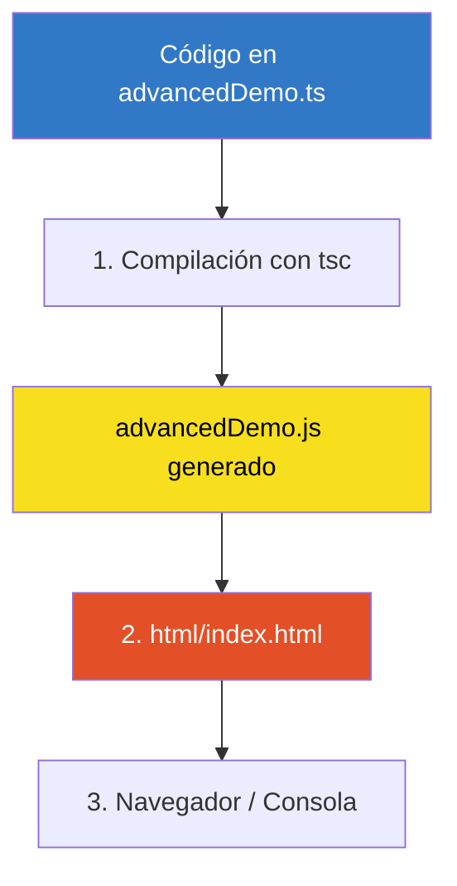

# 📘 Guía Completa: ¿Cómo funciona `tsconfig.json`?

El archivo `tsconfig.json` es el archivo de configuración central de TypeScript. Cumple dos misiones esenciales:

1. **Delimitar el proyecto**: Define qué archivos forman parte del proyecto y cuáles deben ser ignorados.
2. **Definir las reglas del compilador (`compilerOptions`)**: Indica cómo debe transformarse el código TypeScript a JavaScript y qué tan rigurosa debe ser la verificación de tipos.

---

## 📑 Tabla de Contenidos

1. [¿Cómo cambia el comportamiento del comando `tsc`?](#1-cómo-cambia-el-comportamiento-del-comando-tsc)
2. [Estructura Principal de `tsconfig.json`](#2-estructura-principal-de-tsconfigjson)
3. [Explicación de `compilerOptions`](#3-explicación-de-compileroptions)
4. [Control de Archivos: `include` y `exclude`](#4-control-de-archivos-include-y-exclude)
5. [Caso de Estudio: ¿Qué pasó con `main.ts` y `advancedDemo.ts`?](#5-caso-de-estudio-qué-pasó-con-maints-y-advanceddemots)
6. [Flujo de Trabajo Recomendado](#6-flujo-de-trabajo-recomendado)
7. [Diferencia entre este entorno y Next.js](#7-diferencia-entre-este-entorno-y-nextjs)

---

## 1. ¿Cómo cambia el comportamiento del comando `tsc`?

### Sin `tsconfig.json` (Compilación Manual por Archivo)
```bash
tsc main.ts
```
* Obliga a indicar archivo por archivo.
* Usa opciones predeterminadas de TypeScript (suele compilar a versiones antiguas como ES3/ES5).
* No permite gestionar un proyecto entero de forma consistente.

### Con `tsconfig.json` (Compilación de Proyecto)
```bash
tsc
```
* **No necesitas pasar nombres de archivos**.
* `tsc` busca el archivo `tsconfig.json` más cercano en el directorio actual (o en carpetas superiores).
* Compila **todos** los archivos especificados en `include` aplicando las mismas opciones.
* Si intentas correr `tsc miArchivo.ts` existiendo un `tsconfig.json`, TypeScript muestra el error:
  > `error TS5112: tsconfig.json is present but will not be loaded if files are specified on commandline.`
  *(Para forzarlo tendrías que pasar el flag `--ignoreConfig`).*

---

## 2. Estructura Principal de `tsconfig.json`

Un archivo `tsconfig.json` estándar se organiza así:

```json
{
  "compilerOptions": {
    /* Reglas de transformación y verificación */
  },
  "include": [
    /* Patrones de archivos a incluir */
  ],
  "exclude": [
    /* Patrones de archivos o carpetas a ignorar */
  ]
}
```

---

## 3. Explicación de `compilerOptions`

Veamos la configuración de [`html/tsconfig.json`](./tsconfig.json):

```json
{
  "compilerOptions": {
    "target": "ES6",
    "module": "ESNext",
    "strict": true,
    "noEmit": false,
    "sourceMap": true,
    "skipLibCheck": true
  },
  "include": [
    "**/*.ts"
  ],
  "exclude": [
    "index.ts"
  ]
}
```

### Opciones Detalladas:

| Opción | Valor | ¿Qué hace? |
| :--- | :--- | :--- |
| **`target`** | `"ES6"` (o `"ES2020"`, etc.) | Determina la versión de JavaScript resultante. Por ejemplo, transforma clases modernas, funciones flecha o `async/await` al estándar elegido para asegurar compatibilidad con navegadores. |
| **`module`** | `"ESNext"` | Define el sistema de módulos de salida (`import`/`export` estándar de ES Modules, en lugar de `require`/`module.exports` de CommonJS). |
| **`strict`** | `true` | Habilita todas las comprobaciones estrictas de TypeScript (`noImplicitAny`, `strictNullChecks`, etc.). Evita bugs comunes al obligarte a definir tipos claros. |
| **`noEmit`** | `false` | **Crucial en entornos vanilla**: Cuando es `false`, `tsc` genera físicamente los archivos `.js` en disco. Si fuera `true`, solo revisaría errores sin crear archivos `.js`. |
| **`sourceMap`** | `true` | Genera archivos `.js.map`. Permite abrir las DevTools del navegador (F12) y ver/depurar directamente el código `.ts` original con breakpoints, en lugar de ver el `.js` compilado. |
| **`skipLibCheck`** | `true` | Omite la verificación de tipos dentro de archivos `.d.ts` de librerías externas en `node_modules`, acelerando drásticamente el tiempo de compilación. |

---

## 4. Control de Archivos: `include` y `exclude`

### `include`
Define qué archivos debe leer el compilador mediante comodines (*globs*):
* `**/*.ts`: Cualquier archivo que termine en `.ts` en la carpeta actual y en cualquier subcarpeta.

### `exclude`
Archivos o carpetas que el compilador debe ignorar aunque coincidan con el patrón de `include`:
* `"exclude": ["index.ts"]`: Excluye `index.ts` de la compilación si existiera.
* Por defecto, TypeScript siempre excluye `node_modules` a menos que se configure lo contrario.

---

## 5. Caso de Estudio: ¿Qué pasó con `main.ts` y `advancedDemo.ts`?

Durante tus pruebas ocurrieron tres situaciones relacionadas:



1. **Error de comando:** Al principio se ejecutaba `tsc main.ts` sin `tsconfig.json`. Al crearse `tsconfig.json`, ejecutar `tsc advancedDemo.ts` fallaba por la regla `TS5112`. La solución es ejecutar simplemente `tsc`.
2. **Opción obsoleta de TypeScript:** El `tsconfig.json` incluía `"moduleResolution": "node"`, que en TypeScript moderno genera `error TS5108`. Al removerla, `tsc` compila limpiamente.
3. **El enlace en el HTML:** En `index.html` se tenía `<script src="advancedDemo.ts"></script>`. Los navegadores **no pueden interpretar `.ts` directamente**. Debe apuntar al archivo generado `<script src="advancedDemo.js"></script>`.

---

## 6. Flujo de Trabajo Recomendado

### Compilar una sola vez:
```bash
# Dentro de la carpeta html/
tsc

# O desde la raíz del proyecto usando el script de package.json
pnpm html:build
```

### Compilar en tiempo real mientras programas (Modo Watch):
```bash
# Dentro de la carpeta html/
tsc -w

# O desde la raíz del proyecto
pnpm html:watch
```
> **Tip:** Con el modo `-w` (watch), cada vez que presiones `Ctrl + S` en cualquier archivo `.ts`, TypeScript recompilará automáticamente el `.js` correspondiente al instante.

---

## 7. Diferencia entre este entorno y Next.js

En este proyecto tienes **dos** archivos `tsconfig.json` con propósitos totalmente diferentes:

| Característica | `html/tsconfig.json` (Vanilla) | Raíz `tsconfig.json` (Next.js) |
| :--- | :--- | :--- |
| **Genera archivos `.js`** | **Sí** (`noEmit: false`) | **No** (`noEmit: true`) |
| **¿Quién empaqueta?** | El propio compilador `tsc`. | El empaquetador de Next.js (Turbopack / Webpack). |
| **Propósito** | Crear scripts `.js` para que un `<script>` HTML los cargue. | Solo validación de tipos y autocompletado en el editor. |
| **Exclusiones** | `index.ts` | Excluye explícitamente la carpeta `html` para no mezclar entornos. |
