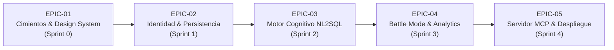

# 🗓️ Plan de Fases, Épicas e Historias de Usuario (Product Backlog)
> **Proyecto**: GitHub Intelligence Platform • **Velocidad Estimada**: 45 - 50 Story Points por Sprint

---

## 📑 Tabla de Contenidos

1. [Estructura de Épicas del Producto](#1-estructura-de-épicas-del-producto)
2. [Sprint 0: Cimientos Arquitectónicos & Design System](#2-sprint-0-cimientos-arquitectónicos--design-system)
3. [Sprint 1: Identidad, Persistencia & Capa Backend](#3-sprint-1-identidad-persistencia--capa-backend)
4. [Sprint 2: Motor Cognitivo NL2SQL & Asistente Flotante](#4-sprint-2-motor-cognitivo-nl2sql--asistente-flotante)
5. [Sprint 3: Módulo Comparador (Battle Mode) & Health Score](#5-sprint-3-módulo-comparador-battle-mode--health-score)
6. [Sprint 4: Servidor MCP, Observabilidad & Despliegue](#6-sprint-4-servidor-mcp-observabilidad--despliegue)

---

## 1. Estructura de Épicas del Producto

El *Product Backlog* está estructurado en 5 grandes Épicas de valor:



---

## 2. Sprint 0: Cimientos Arquitectónicos & Design System
* **Duración**: Semanas 1 y 2
* **Sprint Goal**: Establecer el arnés de ejecución (*Test Harness*), la infraestructura de base de datos local y sincronizar el Design System Aurora Glass de Figma con los componentes React 19.

### 📋 Historias de Usuario (Sprint 0)

#### US-001: Configuración del Pipeline de Integración Continua y Test Harness (5 SP)
* **Como** Desarrollador del equipo,  
* **Quiero** un pipeline automatizado de GitHub Actions que valide tipos, linter y edge-cases en cada Pull Request,  
* **Para** garantizar que ningún commit rompa la estabilidad del repositorio.
* **Criterios de Aceptación (Gherkin)**:
  ```gherkin
  Escenario: Pull Request con error de TypeScript
    DADO QUE un desarrollador sube un cambio con una discrepancia de tipos
    CUANDO el pipeline de GitHub Actions se ejecuta
    ENTONCES el job "tsc --noEmit" falla y bloquea el merge a la rama main.

  Escenario: Suite de pruebas QA pasa exitosamente
    DADO QUE el código cumple con todos los estándares y pruebas
    CUANDO se ejecuta el script qa_audit_test.mjs
    ENTONCES el pipeline reporta 15/15 pruebas aprobadas y emite un check verde.
  ```
* **Asignados**: Javier Beltrán (SecOps), Camila Rondón (QA).

#### US-002: Sincronización del Design System Aurora Glass (5 SP)
* **Como** Diseñador UI y Desarrollador Frontend,  
* **Quiero** una biblioteca de primitivos CVA con Radix UI alineada con los tokens de Figma,  
* **Para** que toda nueva interfaz mantenga la estética de cristal acrílico con soporte de accesibilidad.
* **Criterios de Aceptación (Gherkin)**:
  ```gherkin
  Escenario: Contraste de texto en modo oscuro
    DADO QUE el usuario activa el tema oscuro (Obsidian Aurora)
    CUANDO se mide el contraste de texto contra el fondo translúcido
    ENTONCES la herramienta Axe DevTools certifica un ratio superior a 7:1 (cumplimiento WCAG AAA).
  ```
* **Asignados**: Samanta Ulluke (UI), Lucía Paredes (Frontend).

#### US-003: Modelado del Esquema Inicial en PostgreSQL con Drizzle ORM (8 SP)
* **Como** Ingeniero de Backend,  
* **Quiero** un contenedor Docker con PostgreSQL y esquemas Drizzle tipados para usuarios y repositorios,  
* **Para** soportar las operaciones de persistencia que vendrán en el Sprint 1.
* **Asignados**: Valeria Quispe (Backend DB), Mateo Benavides (BE Lead).

---

## 3. Sprint 1: Identidad, Persistencia & Capa Backend
* **Duración**: Semanas 3 y 4
* **Sprint Goal**: Permitir a los desarrolladores iniciar sesión con su cuenta de GitHub OAuth y guardar repositorios en colecciones personalizadas de forma persistente.

### 📋 Historias de Usuario (Sprint 1)

#### US-101: Autenticación de Usuarios mediante GitHub OAuth2 (8 SP)
* **Como** Usuario de la plataforma,  
* **Quiero** iniciar sesión de forma segura utilizando mi cuenta de GitHub,  
* **Para** que la aplicación tenga una cuota de 5,000 peticiones por hora y acceda a mis repositorios.
* **Criterios de Aceptación (Gherkin)**:
  ```gherkin
  Escenario: Inicio de sesión exitoso
    DADO QUE un usuario hace clic en "Conectar con GitHub"
    CUANDO completa la autorización en la pantalla oficial de GitHub
    ENTONCES el sistema crea su registro en app_users, genera una cookie de sesión HTTP-only y redirige al dashboard.

  Escenario: Sesión caducada
    DADO QUE la cookie de sesión ha expirado
    CUANDO el usuario intenta guardar un repositorio en favoritos
    ENTONCES el servidor responde HTTP 401 Unauthorized y la UI solicita reautenticarse.
  ```
* **Asignados**: Mateo Benavides (BE Lead), Diego Arismendi (Frontend).

#### US-102: Gestión de Colecciones de Repositorios Favoritos (8 SP)
* **Como** Reclutador técnico o Desarrollador,  
* **Quiero** categorizar repositorios investigados en listas con etiquetas y notas privadas,  
* **Para** poder revisar candidatos o arquitecturas de referencia en el futuro.
* **Criterios de Aceptación (Gherkin)**:
  ```gherkin
  Escenario: Guardado con nota técnica
    DADO QUE el usuario tiene una sesión activa
    CUANDO guarda el repositorio "facebook/react" con la etiqueta "Estudio" y una nota
    ENTONCES los datos persisten en la tabla user_favorite_repos y aparecen reflejados instantáneamente en su Bento Grid.
  ```
* **Asignados**: Valeria Quispe (Backend DB), Ana Suárez (UX), Lucía Paredes (Frontend).

#### US-103: Capa de Caché Compartida con Redis (5 SP)
* **Como** Arquitecto del Sistema,  
* **Quiero** que las consultas a perfiles populares se almacenen en Redis con un TTL de 24 horas,  
* **Para** responder en menos de 15ms a usuarios concurrentes y blindar la cuota de red.
* **Asignados**: Valeria Quispe (Backend), Héctor Quintana (Tech Lead).

---

## 4. Sprint 2: Motor Cognitivo NL2SQL & Asistente Flotante
* **Duración**: Semanas 5 y 6
* **Sprint Goal**: Implementar el asistente cognitivo que traduce preguntas en lenguaje natural a consultas SQL seguras sobre los datos del sistema.

### 📋 Historias de Usuario (Sprint 2)

#### US-201: Servicio de Generación de SQL con Claude 3.5 Sonnet (13 SP)
* **Como** Usuario explorador,  
* **Quiero** escribir preguntas en lenguaje natural ("Muéstrame los repositorios de Rust con más de 1000 estrellas"),  
* **Para** obtener resultados instantáneos sin necesidad de aprender sintaxis SQL.
* **Criterios de Aceptación (Gherkin)**:
  ```gherkin
  Escenario: Generación de consulta SELECT válida
    DADO QUE el usuario pregunta "¿Cuáles son los 5 repositorios con más forks de Python?"
    CUANDO el servicio NL2SQLService procesa la solicitud
    ENTONCES genera: "SELECT full_name, forks_count FROM repositories WHERE primary_language = 'Python' ORDER BY forks_count DESC LIMIT 5;"
    Y la respuesta no contiene texto conversacional redundante.
  ```
* **Asignados**: Esteban Salazar (AI Engineer), Sofía Cárdenas (Spec Writer).

#### US-202: Guardrail de Seguridad Determinado `SQLValidator` (8 SP)
* **Como** Auditor de Seguridad del Producto,  
* **Quiero** un módulo que analice y bloquee cualquier comando no-SELECT o destructivo,  
* **Para** neutralizar intentos de inyección SQL, alteración de datos o robo de información.
* **Criterios de Aceptación (Gherkin)**:
  ```gherkin
  Escenario: Detección de inyección destructiva
    DADO QUE el LLM genera una consulta que contiene "DROP TABLE users;"
    CUANDO el validador SQLValidator ejecuta su análisis sintáctico
    ENTONCES bloquea la ejecución, retorna isValid = false y registra la alerta de seguridad.
  ```
* **Asignados**: Ignacio Morales (Security), Esteban Salazar (AI Engineer), Camila Rondón (QA).

#### US-203: Interfaz de Chat Flotante en el Bento Grid (5 SP)
* **Como** Usuario,  
* **Quiero** un modal accesible con animación aurora que me permita consultar al asistente con atajo de teclado (`Cmd+K`),  
* **Para** consultar métricas rápidamente sin abandonar la pantalla principal.
* **Asignados**: Diego Arismendi (Frontend), Samanta Ulluke (UI).

---

## 5. Sprint 3: Módulo Comparador (Battle Mode) & Health Score
* **Duración**: Semanas 7 y 8
* **Sprint Goal**: Diseñar y construir el módulo de comparación cara a cara entre dos repositorios o perfiles con algoritmo de puntuación de salud de código.

### 📋 Historias de Usuario (Sprint 3)

#### US-301: Algoritmo de Cálculo de Health Score (8 SP)
* **Como** Líder Técnico de un equipo,  
* **Quiero** ver un puntaje de salud de 0 a 100 para cada repositorio analizado,  
* **Para** saber de inmediato si una librería está bien mantenida o se encuentra abandonada.
* **Criterios de Aceptación (Gherkin)**:
  ```gherkin
  Escenario: Repositorio saludable
    DADO QUE un repositorio tiene commits en los últimos 15 días, licencia abierta válida y ratio de issues resueltos > 70%
    CUANDO el motor de datos calcula el HealthScore
    ENTONCES el resultado es mayor o igual a 85 puntos con etiqueta "Healthy".
  ```
* **Asignados**: Raúl Corrales (Data Engineer), Mateo Benavides (BE Lead).

#### US-302: Vista Comparativa "Battle Mode" con Gráficos Radiales (8 SP)
* **Como** Usuario,  
* **Quiero** comparar dos repositorios seleccionados en un gráfico radar de métricas clave,  
* **Para** tomar decisiones informadas sobre qué tecnología adoptar en mi empresa.
* **Asignados**: Ana Suárez (UX), Diego Arismendi (Frontend), Samanta Ulluke (UI).

---

## 6. Sprint 4: Servidor MCP, Observabilidad & Despliegue
* **Duración**: Semanas 9 y 10
* **Sprint Goal**: Exponer las capacidades de la plataforma mediante Model Context Protocol (MCP) para agentes de IA externos y desplegar a producción con contenedores Docker y métricas Prometheus.

### 📋 Historias de Usuario (Sprint 4)

#### US-401: Implementación del Servidor Model Context Protocol (MCP) (8 SP)
* **Como** Desarrollador que usa Claude Code o Cursor en su terminal,  
* **Quiero** conectar mi IDE al servidor MCP de la plataforma,  
* **Para** que mi agente pueda consultar la salud de repositorios y mis listas guardadas directamente desde mi terminal.
* **Asignados**: Esteban Salazar (AI Engineer), Héctor Quintana (Tech Lead).

#### US-402: Contenerización en Docker y Métricas con Prometheus (5 SP)
* **Como** Ingeniero DevSecOps,  
* **Quiero** desplegar la aplicación empaquetada en un contenedor Docker optimizado que exponga el endpoint `/metrics`,  
* **Para** monitorear la latencia, consumo de memoria y tasa de errores en tableros de Grafana.
* **Asignados**: Javier Beltrán (SecOps), Ignacio Morales (Security).

#### US-403: Pruebas de Carga y Auditoría Final de Accesibilidad (5 SP)
* **Como** Equipo Scrum,  
* **Quiero** ejecutar pruebas con k6 soportando 200 usuarios concurrentes sin degradar el tiempo de respuesta,  
* **Para** certificar que el producto está listo para el lanzamiento público.
* **Asignados**: Camila Rondón (QA), Ignacio Morales (Security).
