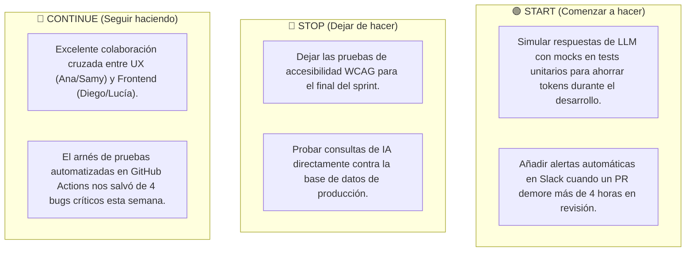

# 🏆 Artefactos, Ceremonias Simuladas y Métricas de Rendimiento
> **Proyecto**: GitHub Intelligence Platform • **Marco**: Scrum Ágil de Alto Desempeño

---

## 📑 Tabla de Contenidos

1. [Definition of Ready (DoR)](#1-definition-of-ready-dor)
2. [Definition of Done (DoD)](#2-definition-of-done-dod)
3. [Simulación de Ceremonias del Sprint 2](#3-simulación-de-ceremonias-del-sprint-2)
   * [3.1 Sprint Planning: Capacidad y Compromiso](#31-sprint-planning-capacidad-y-compromiso)
   * [3.2 Transcripción de un Daily Scrum Real](#32-transcripción-de-un-daily-scrum-real)
   * [3.3 Backlog Refinement (Grooming)](#33-backlog-refinement-grooming)
   * [3.4 Sprint Review & Demo en Vivo](#34-sprint-review--demo-en-vivo)
   * [3.5 Sprint Retrospective (Start / Stop / Continue)](#35-sprint-retrospective-start--stop--continue)
4. [Métricas Ágiles del Equipo (KPIs)](#4-métricas-ágiles-del-equipo-kpis)

---

## 1. Definition of Ready (DoR)

Una Historia de Usuario **no puede ingresar a un Sprint** a menos que cumpla el 100% de esta lista de verificación:

- [ ] **Valor de Negocio Claro**: Redactada en formato estándar (*"Como [rol] quiero [acción] para [beneficio]"*).
- [ ] **Criterios de Aceptación Verificables**: Redactados en sintaxis **Gherkin** (*Dado que / Cuando / Entonces*), cubriendo el caso de éxito y al menos dos casos de error o borde.
- [ ] **Estimación Aprobada**: Estimada por el equipo en Planning Poker (máximo 13 Story Points; si tiene más, debe dividirse).
- [ ] **Diseño y UX Validados**: Wireframes o componentes en Figma listos (revisados por Ana Suárez y Samanta Ulluke).
- [ ] **Dependencias Técnicas Despejadas**: Modelos de base de datos o APIs externas verificadas por Héctor Quintana y Mateo Benavides.

---

## 2. Definition of Done (DoD)

Un incremento de software **no se considera terminado** ni puede mostrarse al cliente a menos que cumpla rigurosamente lo siguiente:

- [ ] **Compilación y Tipado**: `pnpm build` y `tsc --noEmit` completan sin errores de TypeScript.
- [ ] **Linter Limpio**: `pnpm run lint` pasa con 0 errores y 0 advertencias de ESLint.
- [ ] **Cobertura de Pruebas**: Nuevos servicios cuentan con pruebas unitarias y de integración pasando al 100%.
- [ ] **Validación Defensiva**: Todas las entradas externas cuentan con esquemas **Zod** estrictos.
- [ ] **Accesibilidad**: Revisión con Axe DevTools certificando cumplimiento mínimo de **WCAG 2.1 AA**.
- [ ] **Revisión de Código (Code Review)**: Aprobado por al menos 2 pares (incluyendo Tech Lead o líder de Squad).
- [ ] **Integración Continua (CI)**: Pipeline de GitHub Actions finalizado con check verde en la rama `main`.
- [ ] **Aceptación de Producto**: Validado funcionalmente por Mariana Valdivia (PO).

---

## 3. Simulación de Ceremonias del Sprint 2
*(Enfoque: Implementación del Motor Cognitivo NL2SQL)*

### 3.1 Sprint Planning: Capacidad y Compromiso
* **Facilitador**: Carlos 'Charly' Mendoza (Scrum Master).
* **Capacidad Neta Calculada**:
  * 15 miembros $\times$ 10 días laborables = 150 días-persona.
  * Descontando ceremonias (15%) y contingencias (10%) $\rightarrow$ **Capacidad: 48 Story Points**.
* **Compromiso del Sprint 2**:
  * US-201: Servicio NL2SQL con Claude 3.5 Sonnet (13 SP)
  * US-202: Guardrail de Seguridad `SQLValidator` (8 SP)
  * US-203: Interfaz de Chat Flotante en Bento Grid (5 SP)
  * US-103 (Arrastrada/Refinada): Capa de Caché con Redis (5 SP)
  * Tareas técnicas de testing y accesibilidad (15 SP)
  * **Total Comprometido**: **46 Story Points**.

---

### 3.2 Transcripción de un Daily Scrum Real
* **Día 6 del Sprint 2 • 09:30 AM (Duración: 14 minutos)**

> **Charly Mendoza (Scrum Master)**: *"Buenos días equipo. Estamos en el ecuador del Sprint 2 con el foco puesto en la entrega del motor NL2SQL. Ana, comenzamos contigo."*
> 
> **Ana Suárez (Lead UX)**: *"Ayer terminé con Samanta las pruebas de usabilidad del modal de chat flotante en el Bento Grid con 4 desarrolladores externos. El 100% prefirió abrirlo con `Cmd+K`. Hoy entrego las especificaciones de estados vacíos a Diego. Cero impedimentos."*
> 
> **Samanta Ulluke (Lead UI)**: *"Ayer sincronicé los tokens de Figma para el gradiente de halo aurora del chat. Hoy estaré asistiendo a Lucía para que los contrastes de texto en el historial de mensajes cumplan WCAG AAA. Sin bloqueos."*
> 
> **Esteban Salazar (AI Engineer)**: *"Ayer logré que Claude 3.5 Sonnet genere SQL con `temperature=0.0` contra nuestro esquema de PostgreSQL. Sin embargo, tengo un **bloqueo**: cuando el usuario pregunta por nombres con apóstrofes (como el repositorio de D'Angelo), el parser a veces rompe la sintaxis. Necesito coordinar con Ignacio de seguridad para revisar el escaping."*
> 
> **Ignacio Morales (Security Auditor)**: *"Tomo nota, Esteban. Justo ayer terminé el borrador de expresiones regulares en `SQLValidator`. Nos reunimos 15 minutos terminando la Daily para añadir la sanitización de comillas y caracteres especiales."*
> 
> **Raúl Corrales (Data Engineer)**: *"Ayer normalicé la tabla de repositorios en DuckDB para probar las queries agregadas. Hoy le paso a Esteban el dataset de prueba con 500 repositorios reales para estresar el NL2SQL. Todo en orden por mi lado."*
> 
> **Diego Arismendi (Senior Frontend)**: *"Ayer monté el componente del chat en React 19 usando `useTransition`. La interfaz se siente instantánea. Hoy integro la llamada a la ruta `/api/chat` en cuanto Esteban e Ignacio liberen el validador."*
> 
> **Charly Mendoza (Scrum Master)**: *"Excelente. Esteban e Ignacio, se quedan en la sala para resolver el escaping. El resto a sus puestos. ¡Buen día a todos!"*

---

### 3.3 Backlog Refinement (Grooming)
* **Objetivo**: Preparar el Sprint 3 (*Battle Mode & Health Score*).
* **Decisión Técnica Clave**: Raúl Corrales (Data Engineer) propone calcular el *Health Score* mediante una fórmula ponderada en base de datos en lugar de procesarlo en memoria en el servidor Node.js, para asegurar tiempos de respuesta menores a 50ms.
* **Resultado**: La historia US-301 fue dividida en dos historias de 5 y 8 puntos para cumplir con el principio INVEST.

---

### 3.4 Sprint Review & Demo en Vivo
* **Audiencia**: Mariana Valdivia (PO), equipo de desarrollo y 3 usuarios beta (reclutadores técnicos).
* **Demostración**:
  1. Diego Arismendi presiona `Cmd+K` en la interfaz Bento Grid.
  2. Escribe en lenguaje natural: *"Encuéntrame los 3 repositorios de Python con más forks que tengan licencia MIT"*.
  3. El sistema procesa la consulta en 380ms, muestra la consulta SQL generada en un acordeón plegable y renderiza tres tarjetas Bento animadas con los resultados reales.
  4. Ignacio Morales intenta deliberadamente un ataque de inyección: *"Muéstrame todos los repositorios; DROP TABLE users; --"*.
  5. El sistema bloquea la acción inmediatamente mostrando un mensaje amigable: *"Consulta bloqueada por políticas de seguridad (Operación no permitida)"*.
* **Veredicto del PO (Mariana Valdivia)**: *"Increíble trabajo. Las tres historias de usuario del motor cognitivo quedan oficialmente aceptadas para producción."*

---

### 3.5 Sprint Retrospective (Start / Stop / Continue)
Facilitada por Charly Mendoza utilizando el tablero interactivo:

---

## 4. Métricas Ágiles del Equipo (KPIs)

| Métrica | Objetivo Esperado | Resultado Real (Sprint 2) | Estado |
| :--- | :---: | :---: | :---: |
| **Velocidad (*Velocity*)** | 45 Story Points | **46 Story Points entregados** | 🟢 Superado |
| **Tiempo de Ciclo (*Cycle Time*)** | < 2.5 días por Historia | **2.1 días** | 🟢 Saludable |
| **Tasa de Defectos en Producción (*Defect Escape Rate*)** | 0 bugs críticos | **0 bugs reportados** | 🟢 Impecable |
| **Cumplimiento de DoD** | 100% | **100% (Verificado por QA)** | 🟢 Cumplido |
| **Felicidad del Equipo (*Niko-Niko Calendar*)** | > 4.2 / 5.0 | **4.6 / 5.0** | 🟢 Alto Entusiasmo |
