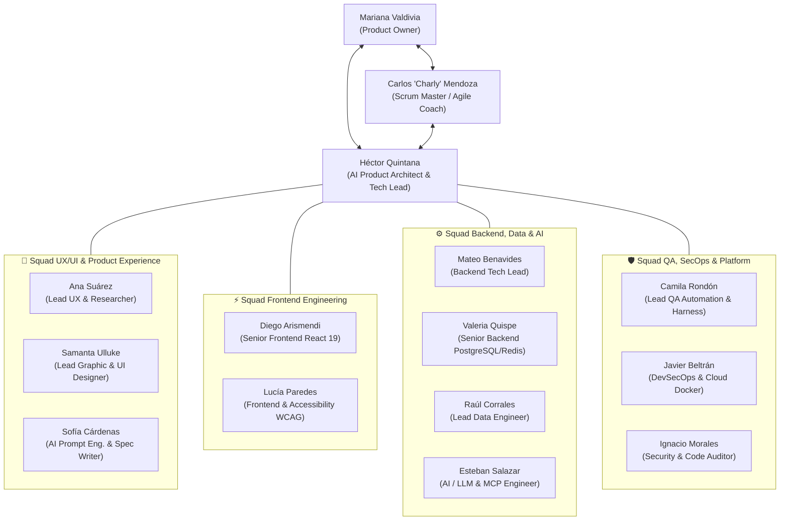

# 🏉 Proyecto Scrum: GitHub Intelligence Platform (Enterprise AI Edition)
> **Metodología**: Scrum Ágil Adaptativo (AI-Augmented Scrum) • **Cadencia**: Sprints de 2 semanas  
> **Duración**: 10 Semanas (Sprint 0 + 4 Sprints Operativos) • **Tamaño del Equipo**: 15 Especialistas

---

## 📑 Índice de la Documentación Scrum

La documentación del simulacro Scrum está organizada en este directorio:

```text
scrum/
├── README.md                          # Visión del producto, marco metodológico y resumen ejecutivo
├── 01_ROLES_Y_EQUIPO.md               # Directorio de los 15 profesionales, squads y matriz RACI
├── 02_PLAN_DE_SPRINTS_Y_FASES.md      # Roadmap, épicas, historias de usuario con Gherkin y tareas
├── 03_ARTEFACTOS_Y_CEREMONIAS.md      # DoR, DoD, simulación de ceremonias (Planning, Daily, Retro) y métricas
└── 04_GLOSARIO_SCRUM.md               # Glosario enciclopédico de términos ágiles y AI-Scrum
```

---

## 🎯 1. Visión del Producto (Product Vision Statement)

> **Para** equipos de ingeniería, reclutadores técnicos y arquitectos de software  
> **Que** necesitan auditar, explorar y comparar el talento y la calidad de repositorios en el ecosistema GitHub sin sufrir por cuotas de API ni análisis superficiales,  
> **La "GitHub Intelligence Platform"**  
> **Es** una plataforma web full-stack de alto rendimiento con interfaz Bento Grid Glassmorphism y motor cognitivo NL2SQL,  
> **Que** permite realizar consultas en lenguaje natural ("Encuentra repositorios de TypeScript con alta actividad de commits y licencia MIT"), comparar desarrolladores en tiempo real (*Battle Mode*) y persistir colecciones personalizadas con métricas de salud automatizadas,  
> **A diferencia de** la interfaz estándar de GitHub o herramientas analíticas estáticas,  
> **Nuestro producto** integra búsqueda sublineal $O(\log n)$, arquitectura por capas desacoplada, servidores MCP para agentes autónomos y análisis de salud de código en tiempo real con cero fricción.

---

## 👥 2. Resumen del Equipo Scrum (15 Profesionales)

El equipo multidisciplinario está distribuido en 4 Squads funcionales bajo la coordinación de Scrum Master y Product Owner:



---

## 🗓️ 3. Roadmap de Releases y Fases

| Fase | Sprint | Fechas Simuladas | Objetivo Central del Incremento |
| :---: | :---: | :---: | :--- |
| **Fase 0: Cimientos** | **Sprint 0** | Semanas 1 - 2 | Arquitectura base, configuración del arnés (*Harness*), CI/CD, esquema PostgreSQL y design system de Figma a Tailwind v4. |
| **Fase 1: Persistencia** | **Sprint 1** | Semanas 3 - 4 | Autenticación con GitHub OAuth, capa de datos en capas (*Layered Backend*), CRUD de colecciones y favoritos con Drizzle ORM. |
| **Fase 2: Motor Cognitivo** | **Sprint 2** | Semanas 5 - 6 | Servicio NL2SQL con Claude 3.5 Sonnet, validador `SQLValidator`, chat flotante en Bento Grid y caché compartida Redis. |
| **Fase 3: Battle & Health** | **Sprint 3** | Semanas 7 - 8 | Módulo comparador (*Battle Mode*), algoritmo de *Health Score* de repositorios y generación dinámica de tarjetas gráficas. |
| **Fase 4: Despliegue** | **Sprint 4** | Semanas 9 - 10 | Servidor MCP para agentes externos, auditoría OWASP, pruebas de carga con k6, métricas Prometheus y lanzamiento oficial. |
